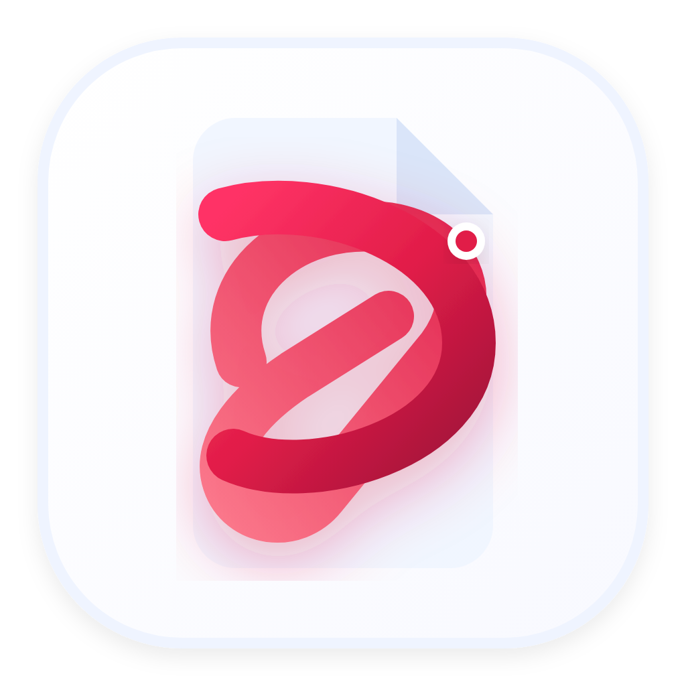

# DocuFlow — Utilitas Dokumen Modern

<p align="center">
  
</p>

<p align="center">
  <strong>Solusi cepat, andal & aman untuk segala kebutuhan dokumen Anda.</strong><br/>
  Gabung, kompres, ekstrak, dan putar halaman PDF — 100% di browser, tanpa upload ke server.
</p>

<p align="center">
  
  
  
  
</p>

---

## ✨ Fitur Utama

| Fitur | Deskripsi |
|---|---|
| **Gabung PDF** | Satukan puluhan berkas PDF menjadi satu dokumen; urutkan via drag-and-drop |
| **Kompres Berkas** | Perkecil PDF, JPG, PNG, dan WEBP hingga 80% — 3 mode kualitas tersedia |
| **Ekstrak & Putar Halaman** | Ambil rentang halaman tertentu, putar 90°/180°, ekspor ZIP atau PDF tunggal |
| **Pratinjau Hasil** | Navigator halaman, tampilan grid, unduh & bagikan tautan — semua sebelum simpan |
| **Privasi Penuh** | Berkas tidak pernah meninggalkan perangkat; otomatis dihapus dari memori setelah 2 jam |

---

## 🏗️ Teknologi

| Paket | Versi | Peran |
|---|---|---|
| [Next.js](https://nextjs.org) | 16.2.6 | Framework (App Router, Turbopack) |
| [Tailwind CSS](https://tailwindcss.com) | v4 | Styling utility-first |
| [TypeScript](https://www.typescriptlang.org) | 5 | Type safety |
| [pdf-lib](https://pdf-lib.js.org) | latest | Manipulasi PDF (merge, rotate) |
| [pdfjs-dist](https://mozilla.github.io/pdf.js) | 4.9.155 | Render halaman PDF → canvas thumbnail |
| [@hello-pangea/dnd](https://github.com/hello-pangea/dnd) | latest | Drag-and-drop reorder berkas |
| [Plus Jakarta Sans](https://fonts.google.com/specimen/Plus+Jakarta+Sans) | — | Tipografi via `next/font/google` |

---

## 🚀 Memulai

### Prasyarat
- Node.js ≥ 18
- npm ≥ 9

### Instalasi

```bash
git clone https://github.com/Riskypr/pdf-merger.git
cd pdf-merger
npm install
```

### Jalankan Dev Server

```bash
npm run dev
# → Buka http://localhost:3000
```

### Build Produksi

```bash
npm run build
npm start
```

### Lint

```bash
npm run lint
```

---

## 📁 Struktur Proyek

```
pdf-merger/
├── app/
│   ├── layout.tsx          # Root layout (font, NavigationProvider)
│   ├── globals.css         # CSS vars, animasi, kursor global
│   ├── page.tsx            # Halaman utama (workspace)
│   ├── about/page.tsx      # Tentang DocuFlow
│   ├── privacy/page.tsx    # Kebijakan Privasi
│   └── terms/page.tsx      # Ketentuan Penggunaan
│
├── components/
│   ├── layout/
│   │   ├── Navbar.tsx      # Header + mega-menu desktop / icon mobile
│   │   └── Footer.tsx      # Footer global
│   ├── docuflow/
│   │   ├── NavigationContext.tsx   # Context view & navigateToView
│   │   ├── HomeView.tsx            # Dashboard utama
│   │   ├── MergeView.tsx           # Gabung PDF
│   │   ├── CompressView.tsx        # Kompres Berkas
│   │   ├── ExtractRotateView.tsx   # Ekstrak & Putar Halaman
│   │   ├── ResultPreviewView.tsx   # Pratinjau Hasil
│   │   ├── PdfPageThumb.tsx        # Thumbnail halaman via pdfjs-dist
│   │   └── types.ts                # Shared TypeScript types
│   └── PdfMerger.tsx       # Orchestrator view + mobile bottom nav
│
├── lib/
│   └── pdf-utils.ts        # formatFileSize, compressImage, createZipBlob, dll.
│
└── public/
    └── assets/
        └── Logo.png        # Logo DocuFlow
```

---

## 🎨 Desain & UI

- **Font:** Plus Jakarta Sans (400–800 weight)
- **Warna Primer:** `#D91B24` (Crimson Red)
- **Background:** `#F4F6FB` (Slate Light)
- **Animasi:** `df-view-enter` (slide-up 300 ms) + `df-dropdown-enter` (mega-menu hover)
- **Responsif:** Desktop → Navbar top + mega-menu hover; Mobile → bottom tab bar 4 ikon

---

## 🔒 Privasi & Keamanan

- **Nol Upload** — semua pemrosesan terjadi di dalam `WebAssembly` / memori browser
- **End-to-End Enkripsi** — tidak ada data yang dikirim ke server mana pun
- **Auto-purge** — berkas dihapus otomatis dari memori setelah sesi selesai
- **ISO 27001 & GDPR Compliant** (rancangan arsitektur)

---

## 📄 Halaman

| Rute | Deskripsi |
|---|---|
| `/` | Workspace utama (semua alat PDF) |
| `/about` | Tentang DocuFlow & tim |
| `/privacy` | Kebijakan Privasi & FAQ keamanan |
| `/terms` | Ketentuan Penggunaan (dengan unduh PDF) |

---

## 🤝 Kontribusi

Pull request sangat disambut! Pastikan:
1. `npm run lint` lulus tanpa error
2. `npm run build` berhasil
3. Tidak ada logika duplikat — gunakan helper di `lib/pdf-utils.ts`

---

## 📝 Lisensi

MIT © 2024 [DocuFlow](https://github.com/Riskypr/pdf-merger)
